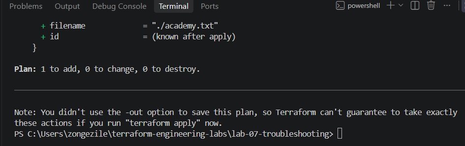
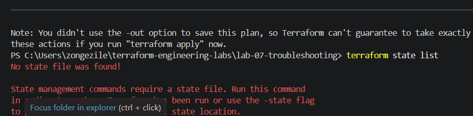
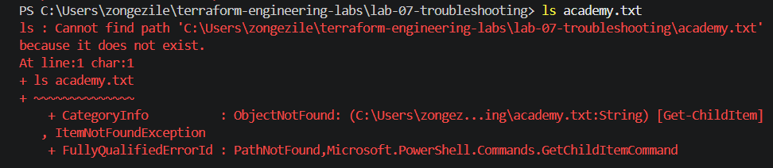
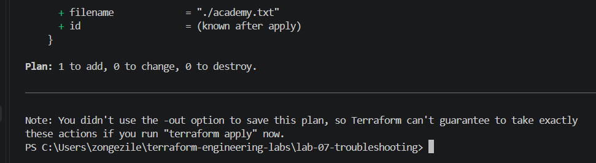
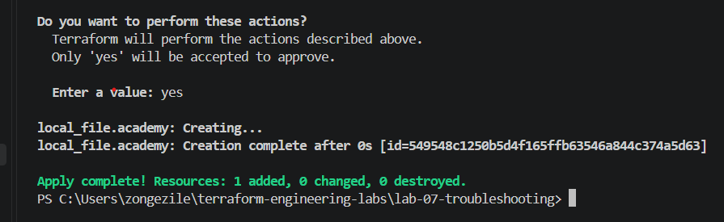
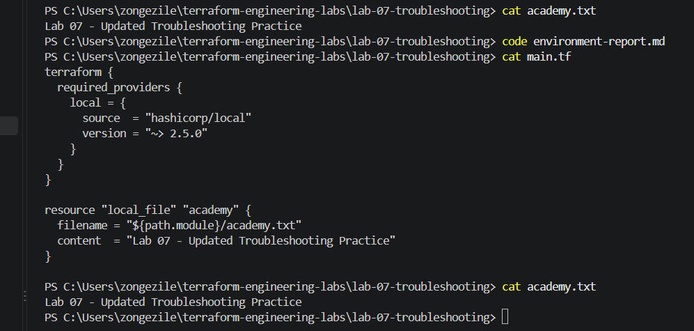

# Lab 07 — Terraform Troubleshooting

## Objective

The purpose of this lab was to learn how to find and fix problems when working with Terraform. I wanted to understand why errors happen and how to solve them instead of just following commands.

## Tools I Used

* Terraform
* VS Code
* PowerShell
* Git and GitHub

## What I Did

### Challenge A — Syntax Error

I started by removing a closing curly bracket from my main.tf file to see what would happen.

When I ran terraform validate, Terraform showed an error. I went back to my code, found the missing bracket and added it back.

I ran the command again, and this time the validation was successful.

### Challenge B — Wrong Directory

For this challenge, I moved out of my Lab 07 folder and ran terraform validate.

The command showed success, but I realised I wasn't actually checking my Lab 07 configuration.

I used pwd to check where I was, then moved back into the correct folder and ran the validation again.

## Screenshot Evidence

I took screenshots showing the errors I encountered and the results after fixing them. I'll include them here to show how I tested and verified my work.

### Challenge A — Syntax Error

### Challenge B — Wrong Directory

### Challenge C — Provider Initialisation

I ran terraform init to check if Terraform could set everything up and download the provider it needed.

The command worked without any errors, so I didn't need to fix anything.

This helped me understand that I should always check the results first instead of assuming there's a problem.

### Challenge D — Unexpected Plan

I started by running terraform plan to see what Terraform was planning to do.

The result showed *1 to add, 0 to change and 0 to destroy*.

I wanted to understand why, so I checked the Terraform state and found that there was no state file. I also checked for academy.txt, but the file wasn't there.

After that, I changed the text in main.tf and ran terraform plan again. The result was still the same because Terraform hadn't created the file yet.

What I learned from this challenge is that I shouldn't just run terraform apply without checking first. I need to understand what Terraform wants to do and why.

### Screenshot Evidence

### Challenge E — Verification Failure

I ran terraform apply to create academy.txt.
Terraform successfully created one resource without any errors.

I checked academy.txt after applying the configuration.

The file contained the same text as main.tf,
so I confirmed that Terraform created it correctly.

## What I Learned

This lab taught me how to troubleshoot Terraform problems step by step.

I learned that even a small mistake in the configuration can cause an error. I also learned why it's important to run Terraform commands in the correct folder.

Another important lesson was to check terraform plan before applying changes, so I understand what Terraform is going to do.

Finally, I learned that a successful deployment is not enough on its own. I still need to check the actual file to make sure everything worked as expected.
