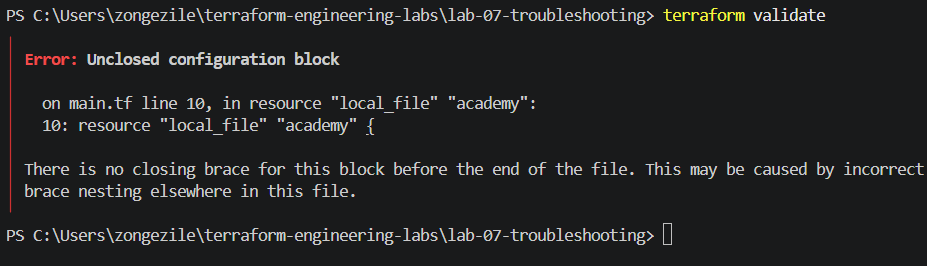
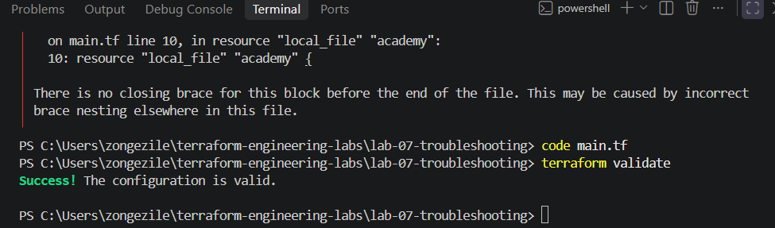
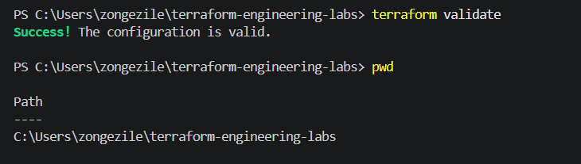
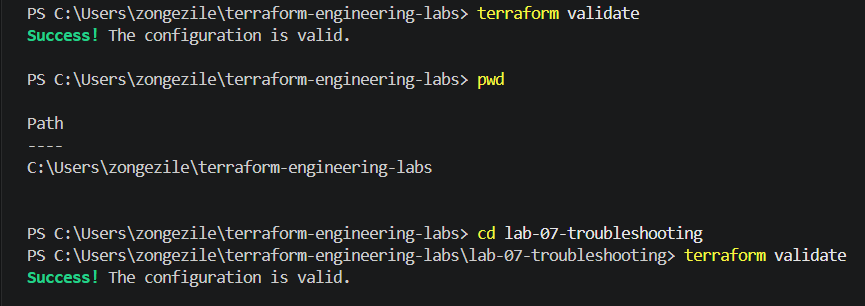
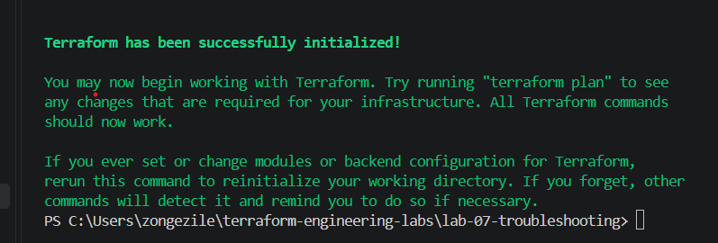

# Lab 07 — Terraform Troubleshooting

## Objective

The purpose of this lab was to learn how to find and fix problems when working with Terraform. I wanted to understand why errors happen and how to solve them instead of just following commands.

## Tools I Used

* Terraform
* VS Code
* PowerShell
* Git and GitHub

## What I Did

### Challenge A — Syntax Error

I started by removing a closing curly bracket from my main.tf file to see what would happen.

When I ran terraform validate, Terraform showed an error. I went back to my code, found the missing bracket and added it back.

I ran the command again, and this time the validation was successful.

### Challenge B — Wrong Directory

For this challenge, I moved out of my Lab 07 folder and ran terraform validate.

The command showed success, but I realised I wasn't actually checking my Lab 07 configuration.

I used pwd to check where I was, then moved back into the correct folder and ran the validation again.

## Screenshot Evidence

I took screenshots showing the errors I encountered and the results after fixing them. I'll include them here to show how I tested and verified my work.

### Challenge A — Syntax Error

### Challenge B — Wrong Directory

### Challenge C — Provider Initialisation

I ran terraform init to check if Terraform could set everything up and download the provider it needed.

The command worked without any errors, so I didn't need to fix anything.

This helped me understand that I should always check the results first instead of assuming there's a problem.

## What I Learned

These challenges helped me understand that troubleshooting is not just about running commands until something works.

I need to understand the problem, check what caused it, make the correction and test again to make sure everything is working properly.
